# iPhone Duo — القبول النهائي (مجال)

تاريخ الجولة: 14 نوفمبر 2026 · الفرع: `duo-final-1114` · النطاق: طبقة العرض فقط (CSS وأصناف وسم وغلاف `div` واحد في ملف الشراكة). لا تغيير على الخادم أو قاعدة البيانات أو الدفع أو الطلبات أو الأسعار أو المصادقة أو المسارات أو النصوص أو إعدادات النشر أو CI.

> كل ما في هذا المستند **محاكاة** في Playwright WebKit (محرك سفاري) بأحجام نوافذ مختلفة. لم يُختبر على جهاز iPhone Duo حقيقي، ولا على Safari iOS. وضعية المفصل الحقيقية (viewport segments) غير مختبرة.

## 1. الخلاصة

- **وضع الكتاب (الشاشة الداخلية):** عند ~669×867 و~951×585 و~669×520 تتحول كل شاشة إلى **صفحتين حول كعب هادئ** (32px، ظل خفيف وخط ذهبي رفيع ثابت في منتصف الشاشة). الصفحة اليمنى (بداية القراءة في RTL) تحمل المهمة نفسها، واليسرى تحمل السياق والهوية والفهرس. الخلفية متصلة من حافة لحافة، ولا نص ولا زر ولا حقل ولا عمود جدول يعبر منطقة الكعب.
- **الوضع المحمول (لابتوب، عريض وقصير):** عند 951×350 و600×350 و594×368 (وكل عرض أفقي ≤480px ارتفاعًا) ينزل شريط الأقسام إلى **شريط سفلي ثابت** في متناول الإبهام، والمحتوى يقرأ فوقه. التذييل يحجز ارتفاع الشريط فلا يغطي آخر سطر، وحقل التركيز يستقر فوقه (`scroll-padding-bottom`)، وزر المساعد يدخل في طرف الشريط من 640px.
- **الشاشة الخارجية (382×580، 385×571، 320×568):** مهمة واحدة واضحة بعمود واحد وخلفية كاملة؛ لم يتغير تخطيط الهاتف.
- **تكبير النص:** شرط الصفحتين يُقاس بـ rem على `body` (استعلام حاوية)، فإذا كُبّر النص إلى 200% تعود الشاشة الداخلية عمودًا واحدًا مقروءًا بدل صفحتين ضيقتين.
- **الحالة لا تضيع:** نفس DOM في كل الأحجام (قواعد عرض فقط، لا شرط عرض في JavaScript)، فالنص المكتوب والتبويب المختار والتصفية والتمرير والنوافذ المفتوحة تبقى عند الطي والفتح.

## 2. كيف صُمّم الكتاب

| السطح | الصفحة اليمنى (المهمة) | الصفحة اليسرى (السياق) |
|---|---|---|
| الرأس | العلامة | أزرار الحساب والتنبيهات؛ شريط الأقسام منقسم على الصفحتين بأوزان متساوية حتى يقع مسار الكعب على المنتصف تمامًا |
| الدليل الذكي | الخطوة التالية وسببها | أزرار «موجّه/بحث/افتح» على بطاقة مستقلة |
| بوابات المبدع والمنشأة والمورد والأدمن والسوبر أدمن | محتوى التبويب المختار (من أعلى الصفحة) | بطل الهوية، الإعلانات، أرقام المنصة، و**فهرس التبويبات** ثابت في مجال الرؤية أثناء التمرير |
| العامة / مشاريع للبيع / السوق | افتتاحية عبر الصفحتين (الوعد يمينًا، العلامة أو الخطوات أو الإطلاق المميز يسارًا)، ثم الرحلة / القائمة / الإطلاقات | الحقائق، المزايا، الإعلانات، الوظائف |
| دليل الموردين | البحث والتصفية والنتائج | تعريف الدليل وزر التسجيل والملاحظة |
| المركز القانوني | المستند | العنوان والتنبيه وتبويبات المستندات و**فهرس المستند** الثابت |
| الصفحات الخاصة (الدفع، الدعوة، التقارير) | الحالة أو التقرير | «صفحة عنوان» هادئة بالعلامة والعنوان |
| ملف الشراكة | أرقام الجمهور والرسوم | العرض، مواقع الإعلان، الخطوات |
| التعريف الأول | الكلام والسؤال | الخيارات أو العلامة |
| النوافذ | النافذة على الصفحة اليمنى والصفحة اليسرى خافتة خلف الستار | — |
| الأدراج والقوائم (المساعد، التبديل، التنبيهات) | — | على الصفحة اليسرى بجانب الزر الذي فتحها |
| التذييل | العلامة والوعد | الأقسام والروابط |

داخل كل صفحة، الشبكات المكتوبة لعرض الشاشة كله (`sm:/md:/lg:grid-cols-*`) تُطوى إلى عرض الصفحة (عمود واحد تحت ~480px)، والشبكات ذات العدد الهاتفي (`grid-cols-2`) تحتفظ به، والصفوف (`sm/md/lg:flex-row`) تتكدس.

**التنفيذ:** قسم واحد جديد في نهاية `src/index.css` («Book spread» + «Laptop posture»)، وأصناف وسم بلا منطق: `majal-spread` على جذر كل سطح، `majal-leaf-aside` / `majal-leaf-opener` / `majal-leaf-index` / `majal-leaf-contents` / `majal-leaf-title` / `majal-leaf-solo` / `majal-split` على الأبناء، و`majal-surface-tabs` في `SurfaceTabs`. لا ملف CSS جديد، لا `!important` جديد، لا كشف للجهاز. خارج أحجام الكتاب هذه الأصناف لا تغير شيئًا.

**المفصل الحقيقي:** لم يُضف `@media (horizontal-viewport-segments: 2)`؛ اختبار `src/lib/duoLayout.test.ts` يمنع صراحة استعلامات الوضعية/المقاطع في `index.css` (لأنها خلف علم تجريبي في Safari). الكعب مركّز على منتصف النافذة. NOT_TESTED على الجهاز.

## 3. تعريف الوضعيات

| الوضعية | المعنى | المقاسات المقيسة |
|---|---|---|
| A | الخارجية مغلقة طوليًا | 382×580، 385×571، 320×568 |
| B | الخارجية عرضيًا | 594×368 |
| C | الكتاب طوليًا | 669×867 |
| D | الكتاب عرضيًا | 951×585 |
| E | لابتوب | 951×350، 600×350 |
| F | داخلية قصيرة / نصف | 669×520، 600×480 |
| G | لوحي/مكتب | 768×1024، 1024×768، 1280×800، 1440×900 |
| H | مراجع الهاتف وتقسيم الشاشة | 360×640، 390×844، 844×390، و320/470/620 × 350/600/900 |
| I | تسلسل حي بلا إعادة تحميل | 951×585 → 669×867 → 470×700 → 382×580 → 594×368 → 951×350 → 951×585 |
| J | إجهاد الوصول | نص 200% (عند 669×867 و382×580)، داكن (951×585 و669×867)، تقليل الحركة، لوحة مفاتيح (951×350 مع حقل مركّز)، حواف أمان غير متماثلة (47px يسارًا عند 594×368) |

## 4. جرد الشاشات

مأخوذ من `src/App.tsx` (الأسطح والصفحات الخاصة والقانونية)، و`SurfaceTabs` في كل بوابة (التبويبات والتبويبات الفرعية)، والنوافذ والأدراج والقوائم والحالات. الوصول بوضع العرض التجريبي (علم الجلسة كما يضعه زر «تجربة العرض»)، وكل نداء `/api/` يُعترض في المتصفح ويُرد عليه بـ 401/404 — لا طلب يصل إلى خادم، ولا طلب ولا دفع يُنشأ.

| # | الشاشة | المعرّف | الوصول | الصفحتان في وضع الكتاب |
|---|---|---|---|---|
| 1 | الصفحة العامة (زائر) | `anon-landing` | `/` بلا جلسة | افتتاحية: الوعد يمين والعلامة يسار؛ الرحلة يمين، الحقائق يسار |
| 2 | نافذة الدخول/التسجيل | `anon-auth-modal` | زائر ← «دخول» | النافذة على الصفحة اليمنى |
| 3 | عن مجال (داخل العرض) | `public` | شريط الأقسام ← «عن مجال» | كالصفحة العامة |
| 4 | التعريف الأول: الترحيب | `onboarding-1` | أول دخول | الكلام يمين، العلامة يسار |
| 5 | التعريف الأول: سؤال الغرض | `onboarding-3` | التالي ×2 | السؤال يمين، الخيارات يسار |
| 6 | مشاريع للبيع | `showcase` | شريط الأقسام | افتتاحية؛ القائمة يمين، الإعلان والمزايا يسار |
| 7 | نموذج «اعرض مشروعك» | `showcase-sell-form` | زر في البطل | النافذة يمين |
| 8 | تفاصيل مشروع معروض | `showcase-listing-detail` | «التفاصيل والتواصل» | النافذة يمين |
| 9 | طلب مساحة إعلانية | `showcase-ad-form` | «اطلب مساحة إعلانية» | النافذة يمين |
| 10 | دليل الموردين | `directory` | شريط الأقسام | البحث والتصفية والنتائج يمين، التعريف يسار |
| 11 | نموذج «سجّل مورّدًا» | `directory-form` | زر في التعريف | النافذة يمين |
| 12 | دليل الموردين: لا نتائج (حالة فارغة) | `directory-empty` | بحث بلا نتائج | الحالة الفارغة يمين |
| 13 | السوق | `consumer` | شريط الأقسام | افتتاحية: العنوان يمين والإطلاق المميز يسار؛ الإطلاقات يمين |
| 14 | نافذة طلب التجربة (بلا إرسال) | `consumer-order-dialog` | «اطلب التجربة» | النافذة يمين |
| 15 | تفاصيل وظيفة كويتية | `consumer-job-dialog` | «عرض والتقديم» | النافذة يمين |
| 16 | قائمة تبديل الهوية | `role-menu` | زر الهوية | القائمة على الصفحة اليسرى |
| 17 | قائمة التنبيهات | `notifications` | زر الجرس | القائمة على الصفحة اليسرى |
| 18 | لوحة البحث | `command-palette` | الدليل ← «بحث» | اللوحة يمين |
| 19 | مساعد مجال (درج) | `ai-drawer` | زر المساعد | الدرج على الصفحة اليسرى |
| 20 | المبدع: الرئيسية | `creator-home` | هوية «مبدع» | المحتوى يمين، الهوية والفهرس يسار |
| 21 | المبدع: رادار الفرص | `creator-radar` | تبويب | المحتوى يمين، الهوية والفهرس يسار |
| 22 | المبدع: منتجاتي | `creator-products` | تبويب | المحتوى يمين، الهوية والفهرس يسار |
| 23 | المبدع: تعاوناتي | `creator-deals` | تبويب | المحتوى يمين، الهوية والفهرس يسار |
| 24 | المبدع: مستحقاتي | `creator-earnings` | تبويب | المحتوى يمين، الهوية والفهرس يسار |
| 25 | معالج تسجيل منتج | `creator-wizard` | «تسجيل منتج جديد» | النافذة يمين |
| 26 | حاسبة الاقتصاديات | `creator-calculator` | «حاسبة الاقتصاديات» | النافذة يمين |
| 27 | خزنة الوصفة | `creator-recipe-vault` | منتجاتي ← «فتح خزنة الوصفة» | النافذة يمين |
| 28 | المنشأة: الرئيسية | `host-overview` | هوية «مالك منشأة» | المحتوى يمين، الهوية والفهرس يسار |
| 29 | المنشأة: اكتشاف المنتجات | `host-discovery` | تبويب | المحتوى يمين، الهوية والفهرس يسار |
| 30 | المنشأة: التحديات | `host-challenges` | تبويب | المحتوى يمين، الهوية والفهرس يسار |
| 31 | المنشأة: المختبر والصفقة | `host-lab` | تبويب | المحتوى يمين، الهوية والفهرس يسار |
| 32 | المنشأة: غرفة الإطلاق | `host-warroom` | تبويب | المحتوى يمين، الهوية والفهرس يسار |
| 33 | المنشأة: المالية | `host-finance` | تبويب | المحتوى يمين، الهوية والفهرس يسار |
| 34 | المنشأة: الفريق والصلاحيات | `host-team` | تبويب | المحتوى يمين، الهوية والفهرس يسار |
| 35 | نشر تحدي ابتكار | `host-publisher` | «نشر تحدي ابتكار» | النافذة يمين |
| 36 | العقد التجاري | `host-contract` | المختبر ← «فتح العقد التجاري» | النافذة يمين |
| 37 | إعلان وظيفة (المنشأة) | `host-job-composer` | «إعلان جديد» | النافذة يمين |
| 38 | المورد: نظرة عامة | `supplier-overview` | هوية «مورد» | المحتوى يمين، الهوية والفهرس يسار |
| 39 | المورد: التوريد | `supplier-supply` | تبويب | المحتوى يمين، الهوية والفهرس يسار |
| 40 | المورد: التوظيف الكويتي | `supplier-jobs` | تبويب | المحتوى يمين، الهوية والفهرس يسار |
| 41 | إعلان وظيفة (المورد) | `supplier-job-composer` | «إعلان وظيفة كويتية» | النافذة يمين |
| 42 | طلبات التوظيف | `supplier-job-applications` | التوظيف ← «طلبات التوظيف» | النافذة يمين |
| 43 | الأدمن: نظرة تشغيلية | `admin-overview` | هوية «أدمن» | المحتوى يمين، الهوية والفهرس يسار |
| 44 | الأدمن: الاعتمادات ← المنتجات | `admin-approvals` | تبويب | المحتوى يمين، الهوية والفهرس يسار |
| 45 | الاعتمادات ← الموردون والوظائف | `admin-approvals-ecosystem` | تبويب فرعي | المحتوى يمين، الهوية والفهرس يسار |
| 46 | الاعتمادات ← دليل الموردين | `admin-approvals-directory` | تبويب فرعي | المحتوى يمين، الهوية والفهرس يسار |
| 47 | الاعتمادات ← مشاريع للبيع | `admin-approvals-listings` | تبويب فرعي | المحتوى يمين، الهوية والفهرس يسار |
| 48 | الاعتمادات ← حملات الشركات | `admin-approvals-campaigns` | تبويب فرعي | المحتوى يمين، الهوية والفهرس يسار |
| 49 | الأدمن: الامتثال والمنشآت | `admin-compliance` | تبويب | المحتوى يمين، الهوية والفهرس يسار |
| 50 | الأدمن: أذونات الوصفات والعقود | `admin-access` | تبويب | المحتوى يمين، الهوية والفهرس يسار |
| 51 | الأدمن: التسويات | `admin-settlements` | تبويب | المحتوى يمين، الهوية والفهرس يسار |
| 52 | الأدمن: الثقة والمخاطر | `admin-risk` | تبويب | المحتوى يمين، الهوية والفهرس يسار |
| 53 | الأدمن: سجل التدقيق | `admin-audit` | تبويب | المحتوى يمين، الهوية والفهرس يسار |
| 54 | السوبر أدمن: مركز القيادة | `super-command` | هوية «سوبر أدمن» | المحتوى يمين، الهوية والفهرس يسار |
| 55 | السوبر أدمن: الصلاحيات | `super-permissions` | تبويب | المحتوى يمين، الهوية والفهرس يسار |
| 56 | السوبر أدمن: سيولة السوق | `super-liquidity` | تبويب | المحتوى يمين، الهوية والفهرس يسار |
| 57 | السوبر أدمن: الثقة والمخاطر | `super-trust` | تبويب | المحتوى يمين، الهوية والفهرس يسار |
| 58 | السوبر أدمن: النظام | `super-system` | تبويب | المحتوى يمين، الهوية والفهرس يسار |
| 59 | السوبر أدمن: سجل التدقيق | `super-audit` | تبويب | المحتوى يمين، الهوية والفهرس يسار |
| 60 | الشروط والأحكام | `legal-terms` | `/terms` | المستند يمين؛ العنوان والتبويبات والفهرس الثابت يسار |
| 61 | سياسة الخصوصية | `legal-privacy` | `/privacy` | كالسابق |
| 62 | سياسة الاسترجاع | `legal-refund` | `/refund` | كالسابق |
| 63 | الامتثال والتتبع | `legal-compliance` | `/compliance` | كالسابق |
| 64 | حالة الدفع (تعذّر العرض) | `payment-return-error` | `/payment/return?order=…` | الرسالة يمين، صفحة عنوان يسار |
| 65 | تقرير المشروع (بيانات العرض) | `gate-report` | `/?my-report=…` في العرض | التقرير يمين، صفحة عنوان يسار |
| 66 | تقرير المشروع: رابط غير صالح | `gate-report-error` | `/?my-report=…` بلا جلسة | الخطأ يمين |
| 67 | تقرير الحملة: خطأ | `ad-report-error` | `/?ad-report=…` | الخطأ يمين، صفحة عنوان يسار |
| 68 | ملف الشراكة (بيانات العرض) | `partner-kit` | `/?partners=…` في العرض | الأرقام يمين، العرض والخطوات يسار |
| 69 | ملف الشراكة: رابط غير صالح | `partner-kit-error` | `/?partners=…` بلا جلسة | الخطأ على الصفحة اليمنى وحدها |
| 70 | قبول دعوة: منتهية | `invite-error` | `/?invite=…` | الخطأ يمين، صفحة عنوان يسار |
| 71 | حالة التحميل (تقرير بطيء) | `loading-fallback` | `/?my-report=…` بطيء | مؤشر التحميل يمين |

**خارج الجرد (BLOCKED):**
- نافذة أمان الحساب/المصادقة الثنائية (`AccountSecurityModal`): لا تظهر إلا بجلسة حقيقية خارج العرض.
- مركز التكاملات (`IntegrationHubModal`): خلف `VITE_ENABLE_INTEGRATION_SIMULATORS` وغير مفعّل في البناء.
- نموذج قبول الدعوة الصالح، وتقرير الحملة/التقرير الحقيقيان: تحتاج رمزًا صالحًا من الخادم؛ غُطيت حالات الخطأ والتحميل ونسخ العرض.
- شاشة نجاح/فشل الدفع الحقيقية: تحتاج طلبًا حقيقيًا — ممنوع في هذه الجولة؛ غُطيت حالة «تعذّر العرض».

## 5. مصفوفة القبول

PASS = لا تمرير أفقي، لا عنصر تفاعلي خارج الشاشة، لا خطأ تحميل، وفي أحجام الكتاب صفر عناصر على الكعب؛ مع مراجعة بصرية للقطات C/D/E/B/A. PARTIAL = تعمل لكن بملاحظة بصرية مذكورة في §8. I = التسلسل الحي على الشاشة نفسها. J = كل متغيرات الإجهاد؛ القياسات كلها نظيفة، لكنها PARTIAL بالمراجعة البصرية لأن صف الرأس (غير المعدّل) يزدحم عند نص 200% (§8 بند 8).

المقاسات المقيسة لكل الشاشات: 669×867، 951×585، 669×520، 951×350، 600×350، 594×368، 382×580، 1280×800، 390×844، 844×390. باقي مقاسات A/F/G/H (385×571، 320×568، 600×480، 768×1024، 1024×768، 1440×900، 360×640، 320/470/620 × 350/600/900) قيست على 18 شاشة ممثلة (الصفحات الرئيسية والبوابات والنماذج والمستند)؛ كلها PASS.

| الشاشة | A | B | C | D | E | F | G | H | I | J | ملاحظة |
|---|---|---|---|---|---|---|---|---|---|---|---|
| الصفحة العامة (زائر) | PASS | PASS | PASS | PASS | PASS | PASS | PASS | PASS | PASS | PARTIAL |  |
| نافذة الدخول/التسجيل | PASS | PASS | PASS | PASS | PASS | PASS | PASS | PASS | PASS | PARTIAL |  |
| عن مجال (داخل العرض) | PASS | PASS | PASS | PASS | PASS | PASS | PASS | PASS | PASS | PARTIAL |  |
| التعريف الأول: الترحيب | PASS | PASS | PASS | PASS | PASS | PASS | PASS | PASS | PASS | PARTIAL |  |
| التعريف الأول: سؤال الغرض | PASS | PASS | PASS | PASS | PASS | PASS | PASS | PASS | PASS | PARTIAL |  |
| مشاريع للبيع | PASS | PASS | PASS | PASS | PASS | PASS | PASS | PASS | PASS | PARTIAL |  |
| نموذج «اعرض مشروعك» | PASS | PASS | PASS | PASS | PASS | PASS | PASS | PASS | PASS | PARTIAL |  |
| تفاصيل مشروع معروض | PASS | PASS | PASS | PASS | PASS | PASS | PASS | PASS | PASS | PARTIAL |  |
| طلب مساحة إعلانية | PASS | PASS | PASS | PASS | PASS | PASS | PASS | PASS | PASS | PARTIAL |  |
| دليل الموردين | PASS | PASS | PASS | PASS | PASS | PASS | PASS | PASS | PASS | PARTIAL |  |
| نموذج «سجّل مورّدًا» | PASS | PASS | PASS | PASS | PASS | PASS | PASS | PASS | PASS | PARTIAL |  |
| دليل الموردين: لا نتائج (حالة فارغة) | PASS | PASS | PASS | PASS | PASS | PASS | PASS | PASS | PASS | PARTIAL |  |
| السوق | PASS | PASS | PASS | PASS | PASS | PASS | PASS | PASS | PASS | PARTIAL |  |
| نافذة طلب التجربة (بلا إرسال) | PASS | PASS | PASS | PASS | PASS | PASS | PASS | PASS | PASS | PARTIAL | فُتحت فقط؛ لم يُرسل أي طلب |
| تفاصيل وظيفة كويتية | PASS | PASS | PASS | PASS | PASS | PASS | PASS | PASS | PASS | PARTIAL |  |
| قائمة تبديل الهوية | PASS | PASS | PASS | PASS | PASS | PASS | PASS | PASS | PASS | PARTIAL |  |
| قائمة التنبيهات | PASS | PASS | PASS | PASS | PASS | PASS | PASS | PASS | PASS | PARTIAL |  |
| لوحة البحث | PASS | PASS | PASS | PASS | PASS | PASS | PASS | PASS | PASS | PARTIAL |  |
| مساعد مجال (درج) | PASS | PASS | PASS | PASS | PASS | PASS | PASS | PASS | PASS | PARTIAL |  |
| المبدع: الرئيسية | PASS | PASS | PASS | PASS | PASS | PASS | PASS | PASS | PASS | PARTIAL |  |
| المبدع: رادار الفرص | PASS | PASS | PASS | PASS | PASS | PASS | PASS | PASS | PASS | PARTIAL |  |
| المبدع: منتجاتي | PASS | PASS | PASS | PASS | PASS | PASS | PASS | PASS | PASS | PARTIAL |  |
| المبدع: تعاوناتي | PASS | PASS | PASS | PASS | PASS | PASS | PASS | PASS | PASS | PARTIAL |  |
| المبدع: مستحقاتي | PASS | PASS | PASS | PASS | PASS | PASS | PASS | PASS | PASS | PARTIAL |  |
| معالج تسجيل منتج | PASS | PASS | PASS | PASS | PASS | PASS | PASS | PASS | PASS | PARTIAL |  |
| حاسبة الاقتصاديات | PASS | PASS | PASS | PASS | PASS | PASS | PASS | PASS | PASS | PARTIAL |  |
| خزنة الوصفة | PASS | PASS | PASS | PASS | PASS | PASS | PASS | PASS | PASS | PARTIAL |  |
| المنشأة: الرئيسية | PASS | PASS | PASS | PASS | PASS | PASS | PASS | PASS | PASS | PARTIAL |  |
| المنشأة: اكتشاف المنتجات | PASS | PASS | PASS | PASS | PASS | PASS | PASS | PASS | PASS | PARTIAL |  |
| المنشأة: التحديات | PASS | PASS | PASS | PASS | PASS | PASS | PASS | PASS | PASS | PARTIAL |  |
| المنشأة: المختبر والصفقة | PASS | PASS | PASS | PASS | PASS | PASS | PASS | PASS | PASS | PARTIAL |  |
| المنشأة: غرفة الإطلاق | PASS | PASS | PASS | PASS | PASS | PASS | PASS | PASS | PASS | PARTIAL |  |
| المنشأة: المالية | PASS | PASS | PASS | PASS | PASS | PASS | PASS | PASS | PASS | PARTIAL |  |
| المنشأة: الفريق والصلاحيات | PASS | PASS | PASS | PASS | PASS | PASS | PASS | PASS | PASS | PARTIAL |  |
| نشر تحدي ابتكار | PASS | PASS | PASS | PASS | PASS | PASS | PASS | PASS | PASS | PARTIAL |  |
| العقد التجاري | PASS | PASS | PASS | PASS | PASS | PASS | PASS | PASS | PASS | PARTIAL |  |
| إعلان وظيفة (المنشأة) | PASS | PASS | PASS | PASS | PASS | PASS | PASS | PASS | PASS | PARTIAL |  |
| المورد: نظرة عامة | PASS | PASS | PASS | PASS | PASS | PASS | PASS | PASS | PASS | PARTIAL |  |
| المورد: التوريد | PASS | PASS | PASS | PASS | PASS | PASS | PASS | PASS | PASS | PARTIAL |  |
| المورد: التوظيف الكويتي | PASS | PASS | PASS | PASS | PASS | PASS | PASS | PASS | PASS | PARTIAL |  |
| إعلان وظيفة (المورد) | PASS | PASS | PASS | PASS | PASS | PASS | PASS | PASS | PASS | PARTIAL |  |
| طلبات التوظيف | PASS | PASS | PASS | PASS | PASS | PASS | PASS | PASS | PASS | PARTIAL |  |
| الأدمن: نظرة تشغيلية | PASS | PASS | PASS | PASS | PASS | PASS | PASS | PASS | PASS | PARTIAL |  |
| الأدمن: الاعتمادات ← المنتجات | PASS | PASS | PASS | PASS | PASS | PASS | PASS | PASS | PASS | PARTIAL |  |
| الاعتمادات ← الموردون والوظائف | PASS | PASS | PASS | PASS | PASS | PASS | PASS | PASS | PASS | PARTIAL |  |
| الاعتمادات ← دليل الموردين | PASS | PASS | PASS | PASS | PASS | PASS | PASS | PASS | PASS | PARTIAL |  |
| الاعتمادات ← مشاريع للبيع | PASS | PASS | PASS | PASS | PASS | PASS | PASS | PASS | PASS | PARTIAL |  |
| الاعتمادات ← حملات الشركات | PASS | PASS | PASS | PASS | PASS | PASS | PASS | PASS | PASS | PARTIAL |  |
| الأدمن: الامتثال والمنشآت | PASS | PASS | PASS | PASS | PASS | PASS | PASS | PASS | PASS | PARTIAL |  |
| الأدمن: أذونات الوصفات والعقود | PASS | PASS | PASS | PASS | PASS | PASS | PASS | PASS | PASS | PARTIAL |  |
| الأدمن: التسويات | PASS | PASS | PASS | PASS | PASS | PASS | PASS | PASS | PASS | PARTIAL |  |
| الأدمن: الثقة والمخاطر | PASS | PASS | PASS | PASS | PASS | PASS | PASS | PASS | PASS | PARTIAL |  |
| الأدمن: سجل التدقيق | PASS | PASS | PASS | PASS | PASS | PASS | PASS | PASS | PASS | PARTIAL |  |
| السوبر أدمن: مركز القيادة | PASS | PASS | PASS | PASS | PASS | PASS | PASS | PASS | PASS | PARTIAL |  |
| السوبر أدمن: الصلاحيات | PASS | PASS | PASS | PASS | PASS | PASS | PASS | PASS | PASS | PARTIAL | في الكتاب الطولي تمرّر المصفوفة أفقيًا داخل إطارها |
| السوبر أدمن: سيولة السوق | PASS | PASS | PASS | PASS | PASS | PASS | PASS | PASS | PASS | PARTIAL |  |
| السوبر أدمن: الثقة والمخاطر | PASS | PASS | PASS | PASS | PASS | PASS | PASS | PASS | PASS | PARTIAL |  |
| السوبر أدمن: النظام | PASS | PASS | PASS | PASS | PASS | PASS | PASS | PASS | PASS | PARTIAL |  |
| السوبر أدمن: سجل التدقيق | PASS | PASS | PASS | PASS | PASS | PASS | PASS | PASS | PASS | PARTIAL |  |
| الشروط والأحكام | PASS | PASS | PASS | PASS | PASS | PASS | PASS | PASS | PASS | PARTIAL |  |
| سياسة الخصوصية | PASS | PASS | PASS | PASS | PASS | PASS | PASS | PASS | PASS | PARTIAL |  |
| سياسة الاسترجاع | PASS | PASS | PASS | PASS | PASS | PASS | PASS | PASS | PASS | PARTIAL |  |
| الامتثال والتتبع | PASS | PASS | PASS | PASS | PASS | PASS | PASS | PASS | PASS | PARTIAL |  |
| حالة الدفع (تعذّر العرض) | PASS | PASS | PASS | PASS | PASS | PASS | PASS | PASS | PASS | PARTIAL |  |
| تقرير المشروع (بيانات العرض) | PASS | PASS | PASS | PASS | PASS | PASS | PASS | PASS | PASS | PARTIAL | بيانات العرض المحلية |
| تقرير المشروع: رابط غير صالح | PASS | PASS | PASS | PASS | PASS | PASS | PASS | PASS | PASS | PARTIAL |  |
| تقرير الحملة: خطأ | PASS | PASS | PASS | PASS | PASS | PASS | PASS | PASS | PASS | PARTIAL |  |
| ملف الشراكة (بيانات العرض) | PASS | PASS | PASS | PASS | PASS | PASS | PASS | PASS | PASS | PARTIAL | بيانات العرض المحلية |
| ملف الشراكة: رابط غير صالح | PASS | PASS | PASS | PASS | PASS | PASS | PASS | PASS | PASS | PARTIAL | بلا جلسة؛ الخطأ على الصفحة اليمنى وحدها |
| قبول دعوة: منتهية | PASS | PASS | PASS | PASS | PASS | PASS | PASS | PASS | PASS | PARTIAL |  |
| حالة التحميل (تقرير بطيء) | PASS | PASS | PASS | PASS | PASS | PASS | PASS | PASS | PASS | PARTIAL | رد الخادم مؤخّر 15 ثانية في الاعتراض |

المجموع: PASS = 639، PARTIAL = 71 (من 710 خلية).

## 6. القياسات

| المقياس | قبل (`origin/main`، 669×867 + 951×585) | بعد (669×867 + 951×585) | بعد (كل المقاسات العشرة) |
|---|---|---|---|
| صفوف القياس (شاشة × مقاس) | 142 | 142 | 998 |
| تعذّر الوصول | 0 | 0 | 0 |
| صفوف فيها تمرير أفقي | 0 | 0 | 0 |
| صفوف فيها عنصر تفاعلي خارج الشاشة | 0 | 0 | 0 |
| عناوين مقصوصة | 12 | 13 | 72 |
| عناصر على الكعب (مجموع) | 4024 | 0 | 0 |
| شاشات فيها عنصر على الكعب | 71 | 0 | 0 |

**أهداف اللمس دون 44px** (قياس مستقل، لا يدخل في PASS/FAIL):
- 1024px فأعرض (1280×800 لكل الشاشات، و1024/1440 للممثلة): 71 شاشة فيها أزرار مكتب مضغوطة (24–40px). مقصود: قاعدة 44px مقيدة بـ `pointer: coarse` حتى 1279px أو بأقل من 768px (قرار سابق موثق في `docs/IPHONE-DUO-ADAPTIVE-QUALITY.md`).
- الهاتف والكتاب واللوحي (أقل من 1024px): العناصر المتكررة هي button «فتح مساعد مجال الذكي» (373)، input «on» (72)، a «support@majal.app» (50)، button «فتح التنبيهات: 2 غير مقروء» (50)، button «فتح التنبيهات: 1 غير مقروء» (20)، button «فتح التنبيهات: 3 غير مقروء» (15). قواعد هذه الجولة لا تصغّر أي هدف (تضيف 44px للـ `summary` فقط)، فهذه كلها سابقة: لسان المساعد الحافّي، مربعات الاختيار الأصلية، رابط البريد داخل النص، وزر الجرس 40px تحت 375px؛ انظر §8.

## 7. التسلسل الحي (I) والإجهاد (J)

- **I لكل شاشة:** 71 من 71 شاشة تجاوزت التسلسل كاملًا بلا إعادة تحميل: التبويب المختار، النافذة/القائمة المفتوحة، عنوان الشاشة، والنص المكتوب (حيث يوجد حقل: 22 شاشة) بقيت كما هي، وصفر تمرير أفقي في كل خطوة.
- **I مفصّل (دليل الموردين):** بحث مكتوب «تغليف»، فئة مختارة «مواد غذائية خام»، تمرير 400px — بعد 951x585 → 669x867 → 470x700 → 382x580 → 594x368 → 951x350 → 951x585: ثابتة كلها.
- **I مفصّل (المبدع ← تعاوناتي + حاسبة الاقتصاديات مفتوحة وفيها قيمة 7):** التبويب والنافذة والقيمة ثابتة في كل الخطوات.
- **J — نص 200% (`html{font-size:200%}`) عند 669×867 و382×580:** 142 قياس، 0 فيها تمرير أفقي أو عنصر خارج الشاشة أو خطأ.
- **J — الثيم الداكن عند 951×585 و669×867:** 142 قياس، 0 فيها تمرير أفقي أو عنصر خارج الشاشة أو خطأ.
- **J — تقليل الحركة عند 669×867:** 71 قياس، 0 فيها تمرير أفقي أو عنصر خارج الشاشة أو خطأ.
- **J — حافة أمان يسرى 47px ويمنى 0 عند 594×368:** 71 قياس، 0 فيها تمرير أفقي أو عنصر خارج الشاشة أو خطأ.
- **J — لوحة المفاتيح (951×350 وحقل مركّز):** 71 قياس، 0 فيها تمرير أفقي أو عنصر خارج الشاشة أو خطأ، الحقل المركّز ظاهر فوق الشريط السفلي في كل الشاشات ذات الحقول (24 شاشة؛ 47 بلا حقل نصي).
- لقطات J مختارة في `docs/iphone-duo-final/J-*.jpg`.

## 8. المشكلات المتبقية

**P0 — لا شيء معروف.** لا تمرير أفقي ولا عنصر خارج الشاشة ولا عنصر على الكعب في أي صف مقيس.

**P1 (تحتاج جهازًا حقيقيًا):**
1. **موضع المفصل:** الكعب مركّز على منتصف النافذة لأن Safari لا يكشف المفصل. إن كان المفصل الفعلي غير متماثل مع حواف الأمان (مثلًا شريط متصفح جانبي)، قد ينزاح الكعب بضع بكسلات عن المفصل. لم يُختبر.
2. **قيم `env(safe-area-inset-*)`:** WebKit على سطح المكتب يعطيها صفرًا؛ اختبار J «الحواف» يحاكي حشوة 47px على الغلاف فقط. الشريط السفلي في وضع اللابتوب يحسب مؤشر الرجوع (`safe-area-inset-bottom`) — يحتاج تأكيدًا في وضع PWA.
3. **لوحة المفاتيح الحقيقية:** اختُبرت بتقصير الارتفاع إلى 350px وتركيز حقل، لا بلوحة iOS. على iOS الشريط السفلي الثابت يختفي خلف لوحة المفاتيح عادة؛ يُتحقق أن الحقل المركّز لا يُغطى.

**P2 (معروفة، ليست من هذه الجولة أو مقبولة بقرار):**
1. **أهداف لمس سطح المكتب (1280×800):** أزرار 24–40px؛ قاعدة 44px مقيدة بالمؤشر الخشن أو أقل من 768px (قرار سابق).
2. **زر المساعد على الهاتف:** لسان حافّي 32×48 مرئيًا مع شريط لمس غير مرئي (قرار سابق).
3. **مربعات الاختيار الأصلية 12×12** في النماذج (الموافقة/الإقرار): التسمية كلها قابلة للنقر؛ وشريط «الحد الأدنى للمطابقة» (`range`) 18px عرضًا في نافذة التحدي عند 600×350 — قبل هذه الجولة.
4. **رابط البريد `support@majal.app`** داخل نص المستند القانوني بارتفاع 16px (رابط داخل سطر، مستثنى من القاعدة عمدًا).
5. **وضع اللابتوب، أول شاشة:** الرأس والدليل وشريط الراعي تأخذ ~45% من 350px قبل التمرير؛ الرأس غير لاصق هنا فيختفي مع أول تمرير، والشريط السفلي يبقى. لم نُخفِ الإعلانات لأن ذلك قرار تجاري.
6. **الكتاب الطولي (صفحة ~290px):** العناوين الطويلة تلتف 3–4 أسطر، ومصفوفة الصلاحيات تمرّر أفقيًا داخل إطارها (لا الصفحة).
7. **تعديل بيانات منتج قيد المراجعة/مرفوض (`ProductReviewStatus`)** — BLOCKED: بيانات العرض لا تحتوي منتجًا قابلًا للتعديل، فالزر لا يظهر.
8. **نص 200%:** عند تكبير جذر الصفحة (`html{font-size:200%}`) يتخلى الكتاب عن الصفحتين ويعود إلى العمود الواحد (الشرط `@container (min-width: 40rem)` يُقاس بـ rem)، فلا صفحات ضيقة بكلمات مكسورة. تبقى الشاشة طويلة جدًا بطبيعة الحال، وفي الرأس تتزاحم علامة «مجال» مع شارة «تجريبي» وجرس التنبيهات (صف الرأس لم يتغير في هذه الجولة عند هذا العرض). تكبير Safari الحقيقي (aA) يغيّر عرض النافذة بالبكسل فيُطبَّق تخطيط الهاتف — يُتحقق على الجهاز.
9. **ملاحظة اختبار فقط:** في بناء الإنتاج، انهارت صفحة ملف الشراكة بخطأ (`measuringSince`) في أول قياس؛ على الأرجح لأن Service Worker تجاوز اعتراض Playwright فوصل الطلب إلى خادم المعاينة الذي يرد بصفحة HTML. السكربت يمنع Service Worker الآن؛ الخادم الحقيقي يرد JSON 404 فلا يحدث. لم يُغيَّر منطق الصفحة (خارج النطاق) — يستحق تقوية لاحقة: التحقق من شكل الرد قبل العرض.
10. **شريط الراعي العام (`AdSlot SPONSOR`)** في الكتاب يوضع على الصفحة اليسرى؛ لم يظهر في القياس لأن الإعلانات تأتي من الخادم (والنداءات معترضة) — NOT_TESTED بصريًا. إعلانات البوابات (`PORTAL`) ظاهرة في بيانات العرض ومقيسة.
11. **عنوان وظيفة مقصوص بنقاط** («مصمم/ة تغليف غذائي») في بطاقة الوظائف على الصفحة اليسرى عند الكتاب — قص مقصود بعلامة الحذف، ويظهر كاملًا في التفاصيل. (عناوين المنتجات المقصوصة الثلاثة موجودة قبل هذه الجولة.)


## 9. قبل / بعد (الشاشة الداخلية)

اللقطات في `docs/iphone-duo-final/` (WebKit، `deviceScaleFactor` 1). «قبل» = `origin/main` (ef41907).

| الشاشة | 669×867 قبل | 669×867 بعد | 951×585 قبل | 951×585 بعد |
|---|---|---|---|---|
| المبدع: الرئيسية | 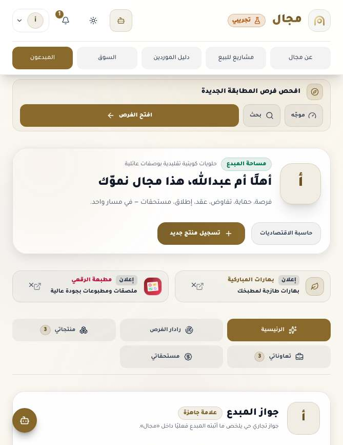 | 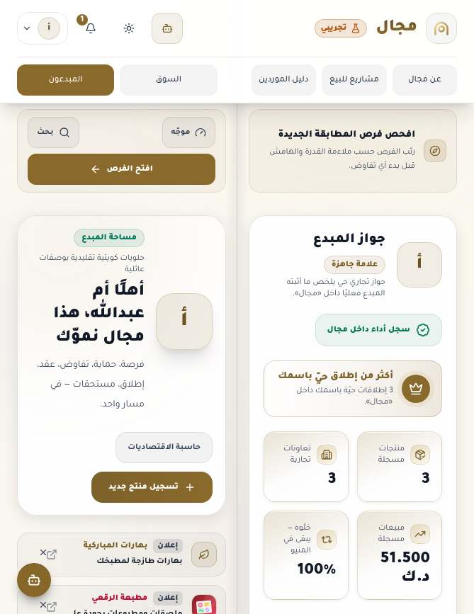 | 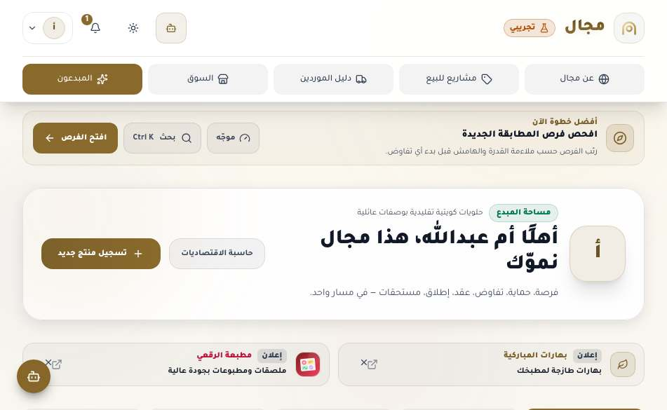 | 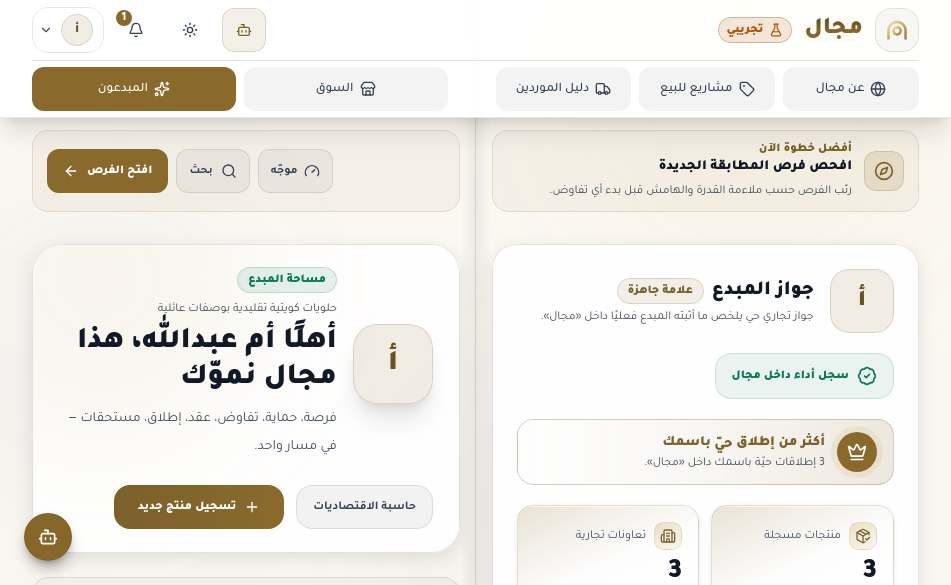 |
| الأدمن: نظرة تشغيلية | 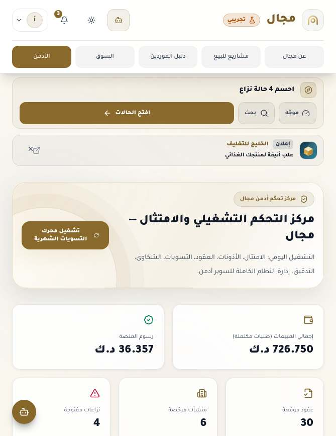 | 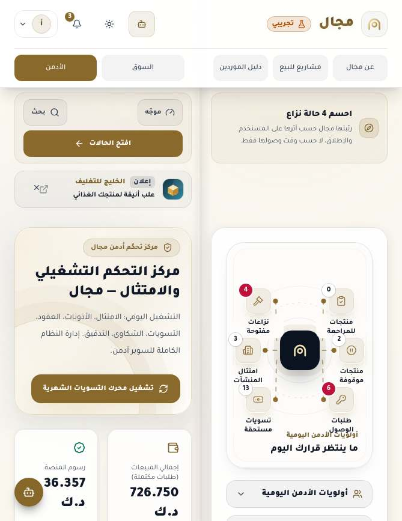 | 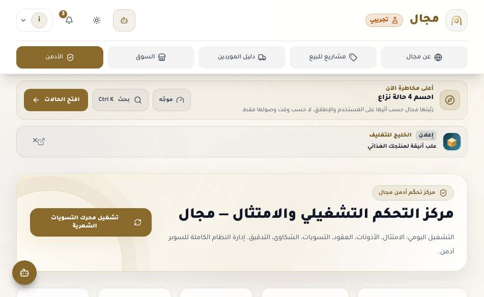 | 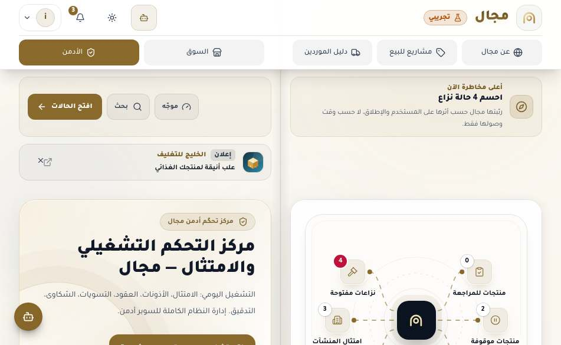 |
| عن مجال (داخل العرض) | 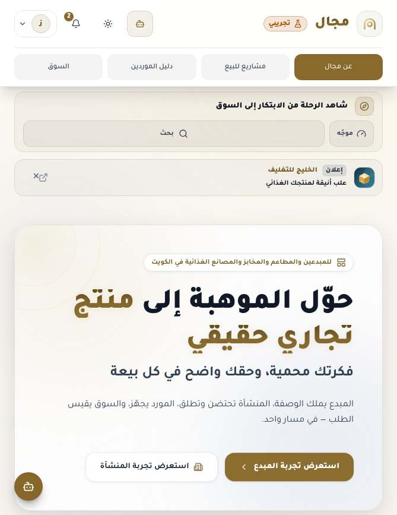 | 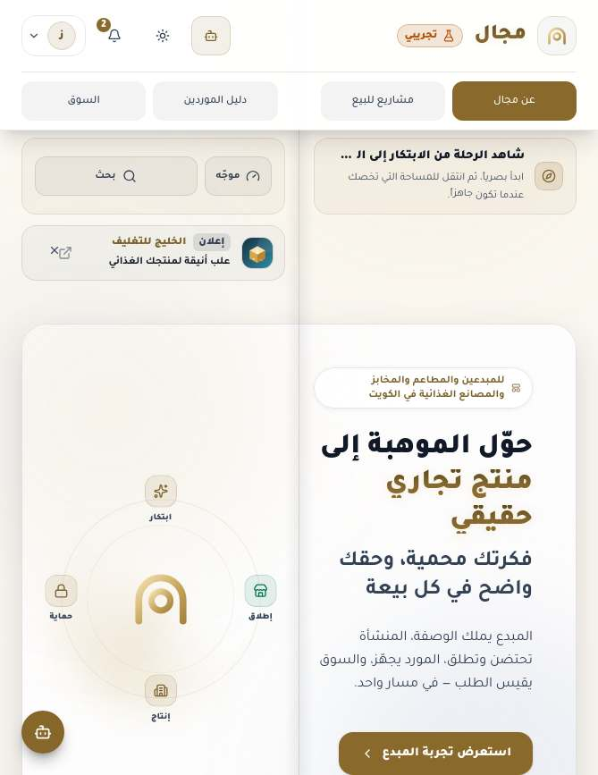 | 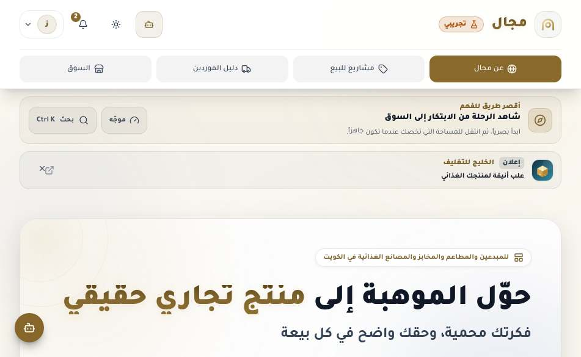 | 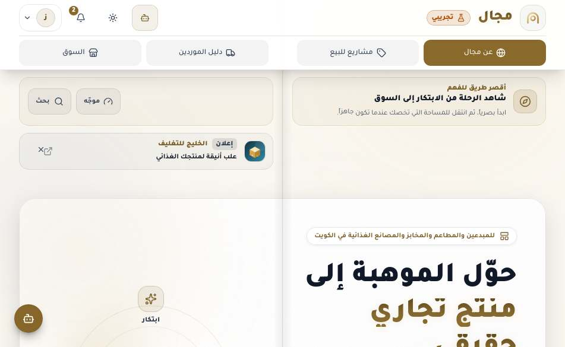 |

وضعيات أخرى (بعد):  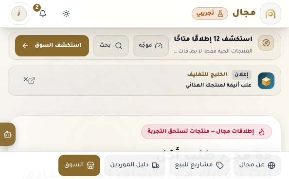 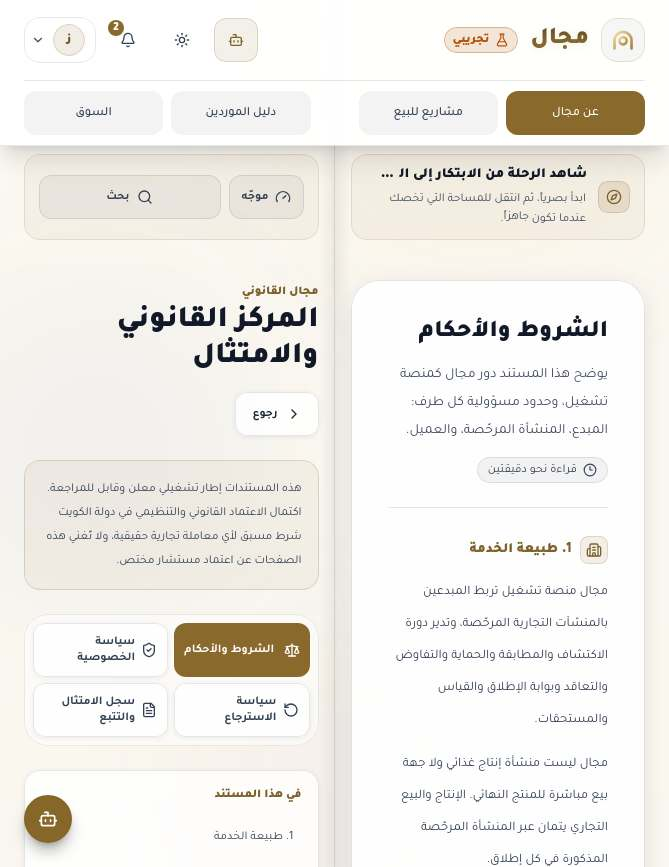 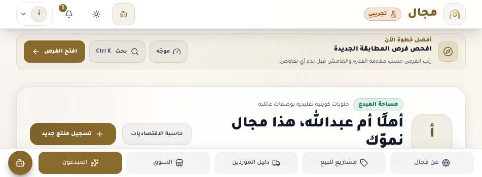 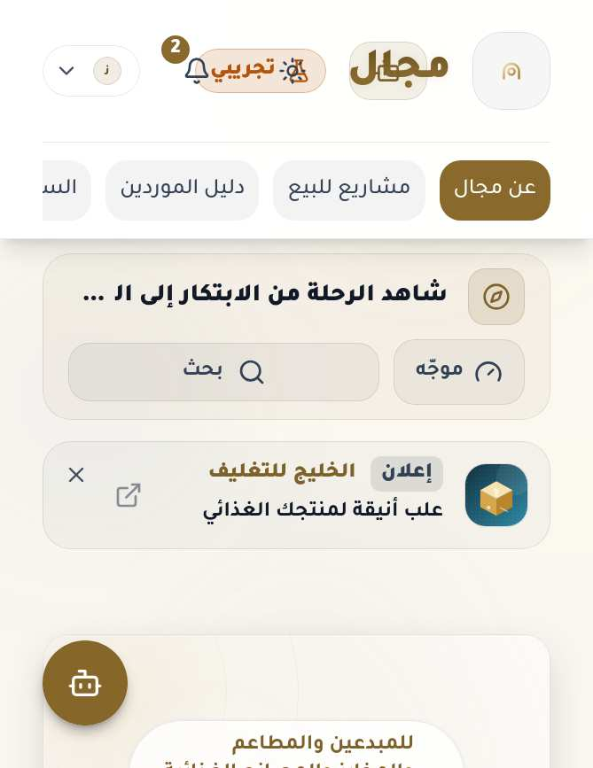 

لقطات «قبل» التُقطت من خادم تطوير يقدّم شيفرة `origin/main` قبل أي تعديل؛ أرقام «قبل» في §6 من بناء `origin/main` في worktree منفصل بنفس السكربت.

## 10. قائمة فحص المالك على الجهاز

1. افتح الشاشة الداخلية كتابًا طوليًا ثم عرضيًا: هل يقع خط الكعب الذهبي على المفصل نفسه؟ هل تبقى كل الكلمات والأزرار بعيدة عن المفصل؟
2. في بوابة المبدع/الأدمن: مرّر الصفحة اليمنى للأسفل؛ هل يبقى فهرس التبويبات في الصفحة اليسرى ظاهرًا؟
3. افتح نافذة (مثل «حاسبة الاقتصاديات»): هل تظهر على الصفحة اليمنى كاملة والصفحة اليسرى خافتة؟
4. افتح الجهاز نصف فتحة (لابتوب): هل ينزل شريط الأقسام إلى أسفل الشاشة العليا، ولا يغطي آخر المحتوى؟ هل زر المساعد داخل الشريط؟
5. اكتب في بحث دليل الموردين، اختر فئة، ثم أغلق الجهاز وافتحه: هل بقي النص والفئة وموضع التمرير؟
6. على الشاشة الخارجية: هل الخلفية تملأ الشاشة، والمهمة واحدة واضحة؟
7. في وضع PWA (من الشاشة الرئيسية): هل يحترم الرأس والشريط السفلي حيز الكاميرا ومؤشر الرجوع؟
8. جرّب الثيم الداكن وتكبير النص من إعدادات سفاري (aA): هل يبقى كل شيء مقروءًا؟

## 11. إعادة القياس

```bash
npm ci && npm run build:client
npx vite preview --port 5180 --strictPort --host 127.0.0.1      # أو: DISABLE_HMR=true npx vite --port 5180 --strictPort --host 127.0.0.1
NODE_PATH=/opt/node22/lib/node_modules PLAYWRIGHT_BROWSERS_PATH=/opt/pw-browsers \
  node docs/iphone-duo-final/duo-final-audit.cjs --resize --with-ij --out /tmp/duo-audit
# شاشة أو مقاس محدد: --screens creator-home,legal-terms --vps 669x867,951x585
# تحميل جديد لكل مقاس بدل تغيير الحجم: احذف --resize
```

السكربت يكتب `report.json` (المصفوفة، `stress`، `liveAll`) ولقطات JPEG للمقاسات 669×867، 951×585، 951×350، 600×350، 594×368، 382×580، 669×520، 1280×800. الوضع `--resize` يصل إلى كل شاشة مرة واحدة عند 951×585 ثم يقيس كل المقاسات بتغيير حجم الصفحة نفسها؛ هذا مكافئ لتحميل جديد هنا لأن التخطيط CSS فقط (لا قراءة لعرض النافذة في JavaScript — تحقّقنا بالبحث عن `innerWidth/matchMedia/resize`).

## 12. الاختبارات

| الفحص | `origin/main` (ef41907) | هذا الفرع |
|---|---|---|
| `npm run lint` (`tsc --noEmit`) | PASS | PASS |
| `npm test` | PASS — 266 ناجح، 0 فاشل، 1 متجاوز | PASS — 269 ناجح، 0 فاشل، 1 متجاوز (3 اختبارات جديدة في `src/lib/duoLayout.test.ts`) |
| البناء | `vite build` PASS (تحذير حجم chunk موجود سابقًا) | `npm run build` كاملًا (PWA + vite + خادم esbuild) PASS، نفس التحذير |
| اختبار يمنع استعلامات الوضعية/المقاطع | PASS | PASS — لم يُضف `viewport-segments` |

الاختبارات الجديدة: (1) نطاقا الكتاب موجودان والجذر شبكة صفحتين حول `--spine` والشريط متوازن الوزن؛ (2) كل جذر سطح يحمل `majal-spread`؛ (3) وضع اللابتوب يثبت الشريط أسفل الشاشة ويحجز ارتفاعه في التذييل وفي `scroll-padding-bottom`.

